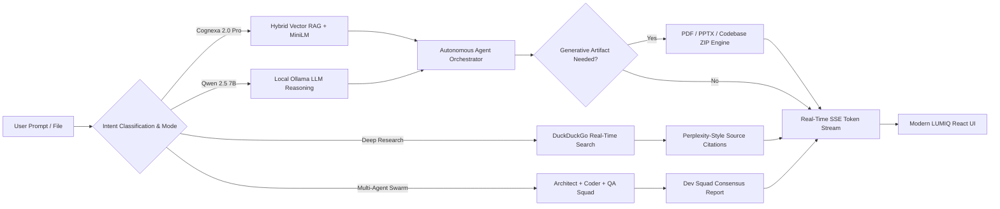

<div align="center">

# 🧠 Cognexa AI
### Autonomous Intelligence · Persistent Vector Memory · Real-Time Web Research · Generative Studio

[](https://nextjs.org/)
[](https://fastapi.tiangolo.com/)
[](https://python.org)
[](https://www.typescriptlang.org/)
[](https://tailwindcss.com/)
[](https://ollama.com/)
[](https://vercel.com/)
[](LICENSE)

<br/>

**Cognexa AI** is an open-source, full-stack autonomous AI engineering assistant and research workspace designed to bridge the gap between simple conversational chatbots and actionable, verifiable software deliverables.

[Features](#-key-features) · [Operational Modes](#-4-operational-modes) · [Architecture](#-architecture) · [Quick Start](#-quick-start) · [API Documentation](#-api-documentation) · [Deployment](#-deployment)

</div>

---

## 🌟 Key Highlights

- **🧠 Persistent Vector Memory**: Dual-tier episodic & semantic memory using pgvector / SQLite embeddings with cosine similarity matching.
- **🌐 Deep Research Grounding**: Real-time web search with Perplexity-style verified source citations `[1]`, `[2]` preventing LLM hallucinations.
- **🤖 Multi-Agent Dev Squad**: Autonomous consensus collaboration between a Principal Architect, Lead Coder, and Security Auditor.
- **📄 Generative Artifact Studios**: Dynamic generation of ready-to-download, multi-page PDFs, PowerPoint `.pptx` decks, and project codebases (`.zip`).
- **🎨 Glassmorphic LUMIQ UI**: Dual Light/Dark themes, responsive chat history, multi-tab execution, and real-time SSE token streaming.
- **🛡️ Self-Verification & Sandboxing**: Approval-gated execution plan verification with Docker sandboxing and test runners.

---

## 🔄 How Cognexa AI Works



---

## 🚀 4 Operational Modes

Cognexa AI features 4 distinct execution modes accessible via the top-header model selector:

| Mode | Engine | Best For | Capabilities |
| :--- | :--- | :--- | :--- |
| **⚡ Cognexa 2.0 Pro** | Hybrid Multi-Modal | General Tasks & Coding | Vector memory retrieval, attached document RAG, automated task planning. |
| **🧠 Qwen 2.5 7B Core** | Local Ollama | Privacy & Zero-Latency | Offline chain-of-thought, algorithmic analysis, local LLM execution. |
| **🌐 Deep Research Mode** | Real-Time Web | Current Facts & News | Live DuckDuckGo search, verified markdown citations `[1]`, `[2]`, zero hallucinations. |
| **🤖 Multi-Agent Swarm** | Dev Squad Consensus | Complex Engineering | 3-agent autonomous team: Architect, Lead Coder, Security Auditor. |

---

## 🛠️ Generative Studios & Tools

Cognexa AI includes dedicated standalone studios accessible from the sidebar:

* **📑 Document Studio**: Compiles comprehensive page-wise PDFs with custom headers, typography, and page numbers.
* **📊 Presentation Studio**: Generates formatted, multi-slide 16:9 `.pptx` presentations ready for keynote delivery.
* **📦 Software ZIP Studio**: Generates modular full-stack projects packaged into directly downloadable `.zip` archives.
* **🎨 Image Studio**: Produces visual mockups, diagrams, and illustrations directly in chat.
* **📎 Multi-Format Document RAG**: Upload any PDF, Markdown, Python, or text file (up to 30MB) for instant chunking, semantic retrieval, and contextual answering.

---

## 🏗️ System Architecture

```text
cognexa-ai/
├── frontend/                     # Next.js 14 Production Frontend
│   ├── src/
│   │   ├── app/                  # App Router Pages (/chat, /dashboard, /memory, /tasks)
│   │   ├── components/           # UI Components (Sidebar, ChatMessage, Modals, Studios)
│   │   ├── stores/               # Zustand Global State (chatStore, authStore, themeStore)
│   │   └── lib/                  # Axios & Fetch SSE Streaming Clients
│   ├── tailwind.config.ts        # Custom Dark & Light Theme Palette
│   └── vercel.json               # Vercel Deployment Configuration
│
├── backend/                      # FastAPI Asynchronous Microservice
│   ├── app/
│   │   ├── agent/                # LangGraph Workflows, Tools & System Prompts
│   │   ├── routes/               # API Endpoints (/chat, /auth, /memory, /tasks)
│   │   ├── services/             # Core AI Services:
│   │   │   ├── agent.py          # Flagship Orchestrator
│   │   │   ├── agent_swarm.py    # Autonomous Dev Squad
│   │   │   ├── web_search.py     # Live DuckDuckGo Research Grounding
│   │   │   ├── document_rag.py   # Vector Document Indexing & Retrieval
│   │   │   ├── content_synthesizer.py # Adaptive Multi-Domain Content Engine
│   │   │   └── generators/       # Native PDF, PPTX, and Project ZIP Builders
│   │   ├── models/               # SQLAlchemy Async Models (User, Conversation, Message, Memory)
│   │   ├── database.py           # Async Engine with SQLite WAL Mode & pgvector Support
│   │   └── main.py               # Application Entrypoint & CORS Configuration
│   └── requirements.txt          # Python Dependencies
│
├── docker-compose.yml            # Containerized Orchestration (PostgreSQL + Backend + Frontend)
└── Makefile                      # Developer Task Runner
```

---

## ⚡ Quick Start Guide

### Prerequisites
* **Node.js** >= 18.x
* **Python** >= 3.11
* *(Optional)* **Ollama** with `qwen2.5:7b` installed: `ollama run qwen2.5:7b`

### 1. Clone Repository
```bash
git clone https://github.com/your-username/cognexa-ai.git
cd cognexa-ai
```

### 2. Backend Setup
```bash
cd backend
python -m venv venv

# Windows:
.\venv\Scripts\activate
# Linux / macOS:
source venv/bin/activate

pip install -r requirements.txt
python -m uvicorn app.main:app --host 0.0.0.0 --port 8000 --reload
```
*Backend API will be running at:* `http://localhost:8000` *(Interactive Swagger Docs at:* `http://localhost:8000/docs`*)*

### 3. Frontend Setup
```bash
cd ../frontend
npm install
npm run dev
```
*Frontend Application will be live at:* `http://localhost:3000`

---

## 🐳 Docker Deployment

To spin up the complete stack (PostgreSQL with pgvector, FastAPI backend, and Next.js frontend) with a single command:

```bash
docker-compose up -d --build
```

---

## 🌐 Deploy to Vercel

The frontend is fully configured for zero-config Vercel deployment:

1. Import the `frontend` directory into your [Vercel Dashboard](https://vercel.com/new).
2. Set Environment Variables:
   ```env
   NEXT_PUBLIC_API_URL=https://your-backend-api.com
   ```
3. Deploy!

---

## 🧪 Default Test Credentials

For quick evaluation, the database auto-seeds a default test account on first launch:
* **Email**: `admin@cognexa.ai`
* **Password**: `admin123`

---

## 🛡️ License

This project is licensed under the **MIT License** — feel free to use, modify, and distribute it for personal and commercial projects.

<div align="center">
<b>Built with passion for the future of Autonomous AI Agents.</b>
</div>
